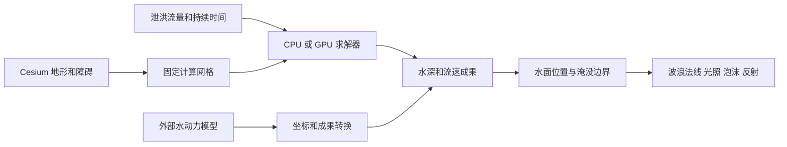

# 水面效果、洪水推演与 ShaderToy

## 先看我们希望得到什么

向水库下游释放 350 m³/s，需要先算出每个位置的水深和流速，才能回答“水何时到达挡墙、是否漫顶、下游哪里被淹”。之后再把这些结果画成水：表面有细小波浪，掠射角看到反光，岸边出现浅水和泡沫。

这两个步骤都可以写 shader，但它们承担的任务不同。换一个漂亮的水面 shader，并不自动得到可靠的泄洪推演。反过来，计算有守恒，也不自动得到漂亮的画面。

## 找到的案例与可以确认的内容

| 案例 | 可以确认的内容 | 对本项目的意义 |
| --- | --- | --- |
| [B站：Cesium 代码开源 水面效果 带顶点计算的水面](https://www.bilibili.com/video/BV1sJHSefEhq/)；[公开源码](https://github.com/shaonianla1997/source/blob/main/20240906/water_world.js) | 页面说明有顶点变换、地形岸线和水深调整；源码以 WATER_LEVEL 与 heightMap 比较，结合程序波浪和波浪梯度法线着色 | 是水面渲染参考；公开文件中这一水位比较不能等同于按泄洪体积更新相邻单元的守恒推演 |
| [B站：Cesium流体模拟效果开源 Fluid Simulation；WebGL Primitive DrawCommand Shadertoy](https://www.bilibili.com/video/BV1Hngf6FEqC/) | 已打开并播放试看，能看到地形上的水体；标题明确提及 ShaderToy/GPU，说明让读者通过公众号获取代码包 | 是直接的效果参照；当前没有获取其代码包，不能确认方程、质量误差或挡墙实现，也不假定与上一个公开文件是同一算法 |
| [B站：Cesium水面应用／河道模拟／水上水下／海面仿真](https://www.bilibili.com/video/BV1wE4m1d7D4/) | 检索到作者的水面应用展示说明 | 可作为水面观感的候选参考；此轮未完整观看，也未审计其实现 |
| [ShaderToy：Macroscopic LBM Shallow Water](https://www.shadertoy.com/view/NdXyRB)；[作者说明](https://www.nicoell.dev/ocean-simulation/) | 作者公开说明用宏观格子玻尔兹曼方法求解浅水流，并链接交互 ShaderToy | 证明 shader 可以承担真正的浅水数值计算；ShaderToy 本页访问受限，此轮依据作者说明和原论文理解，尚未审计或移植其 shader |

宏观 LBM 原论文：[Jian Guo Zhou, Macroscopic Lattice Boltzmann Method for Shallow Water Equations](https://arxiv.org/abs/1902.02999)。它与本项目的局部惯性近似是不同数值方法；不能因为都输出水深，就假定稳定条件和边界实现相同。

## 一个 shader 怎样计算水流

普通渲染 shader 输出屏幕颜色。用于计算的 shader 则输出一张数据纹理：每个像素对应一个网格单元，颜色通道装的是水深、速度或通量，而不是看见的蓝色。

例如某个算法可以把 R 存水深、G/B 存两个速度分量；另一个算法可能用多张纹理存四个方向的通量。这是算法自己的数据布局，不能把任意 ShaderToy 的 RGBA 都按同一种含义读取。

下一步计算时，shader 读取当前单元及相邻单元，依据地面、压力差、阻力和边界条件更新状态。GPU 能同时处理许多单元，因此适合大网格。WebGL 中通常在两组纹理间交替：读取 A、写入 B，然后读取 B、写入 A；不能同时采样正在写入的同一纹理。这种方式常被叫作 ping-pong。

“用 shader”改变的是执行位置和数据存放方式。水动力方程、米/秒单位、时间步、湿干边界、墙顶过流和守恒仍然要定义。只有模拟波纹的波动方程，也不能直接替代有大水量输运和干地变湿的洪水模型。

## 为什么我们第一版的水显得平

第一版的水位来自网格求解，但微小波纹只是把正弦值加到颜色里。几何法线没有随细小波浪改变，光线没有形成足够的明暗和高光变化；流速带动规则纹样，还容易显出重复条纹。

这次增加了可开关的“细节水面”，关闭可直接对比基础效果，计算成果不变：

- 六组不同方向和尺度的程序波浪，使用波浪高度的梯度改变像素法线，得到随观察角度变化的高光。
- 两阶段的流速平流：细节跟随输入速度移动，并交替淡入淡出，避免纹理在不均匀流场中无限拉长。
- 根据水深衰减颜色，结合 Fresnel 掠射反射和程序天空。这里反射的是近似天空，尚未反射场景里的真实山体或建筑。
- 浅水岸边泡沫和高速区的破碎细节。泡沫由水深/速度生成，是表现层近似，不能作为模型中的含气量或湍流输出。
- 波纹时钟使用实际绘制时间，不再假设每秒固定 60 帧。暂停推演后微小波纹仍会动，但水深和输入水量不再增加。

本次没有复制上述第三方源码，也没有集成需要改动 Cesium 引擎的商业扩展。新增 shader 是本项目自己实现的程序材质，仍通过公共 Primitive、Appearance、Material 接口接入。

## 接下来怎样继续对比

目前 12 m 网格只适合第一轮宏观路径验证；细沟、窄墙和流前沿会显得粗。提高着色细节能改善反光，却不能恢复网格没有表达的地形。应分别评估计算分辨率与显示分辨率。

GPU 原型适合后续在同一个地形、同一个泄洪过程上与当前 CPU 解算器比较。至少记录：总输入、域内存水、边界输出、质量误差、湿区变化、挡墙前积水及首次漫顶时间；再比较性能。普通湖面波纹、平面二维烟雾或没有湿干边界的流体 shader 不能通过这组洪水案例。

真实反射与折射还需要场景颜色、深度、反射相机或屏幕空间计算。Cesium 场景有地球坐标、多个视锥和深度精度问题；后续应专门设计与版本兼容的渲染接入层。漫顶瀑布、飞溅和桥下过水也需要额外几何、粒子或结构表示，单层水深网格不会自动生成它们。

对于以后 npm 包的接口，CPU/GPU 解算器都应输出相同的水深/流速语义；外部模型也转换到这层。求解器可以替换，漂亮水面应同时服务三条成果来源，而不绑定某一个 ShaderToy。
